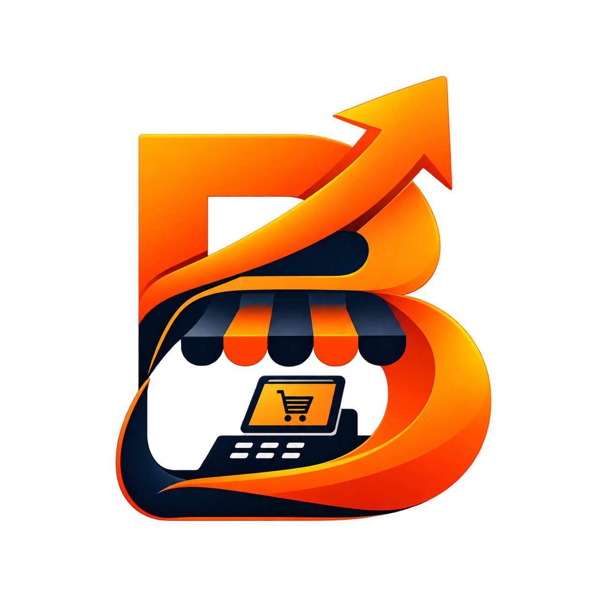

  

<h1 align="center">BeBoss — The Retail Operating System</h1>

  <strong>Sell faster. Stay in control. Grow every location.</strong>

  One connected platform for point of sale, inventory, purchasing, customers, finance, teams, branches and business performance.

  <a href="https://beboss.rw"><strong>Explore BeBoss</strong></a>
  &nbsp;·&nbsp;
  <a href="https://beboss.rw">Product website</a>

---

## Your whole shop. One clear view.

Running a retail business means balancing customers, stock, suppliers, cash, staff and daily decisions—often across more than one location. BeBoss brings those moving parts into one connected operating workspace.

From the counter to the back office, owners and teams can record sales, manage stock, follow customer balances, coordinate branches and understand performance without juggling disconnected tools.

Designed with the realities of Rwanda and East African retail in mind, BeBoss combines practical point-of-sale workflows with the visibility and controls growing businesses need.

## Built for the work that happens every day

<table>
  <tr>
    <td width="50%">
      <h3>⚡ Point of sale that keeps business moving</h3>
      
Serve customers with product search, barcode-assisted workflows, discounts, held carts, split tenders, customer credit and clear receipts. Keep the checkout flow focused on completing the sale and recording the result.

    </td>
    <td width="50%">
      <h3>📦 Inventory you can act on</h3>
      
Manage product details, stock quantities, cost and selling prices, reorder thresholds, stock adjustments, purchasing and transfers. See what needs attention before an empty shelf becomes a lost sale.

    </td>
  </tr>
  <tr>
    <td width="50%">
      <h3>🤝 Customers and account balances</h3>
      
Keep customer records, purchase history, outstanding balances and payment activity together. Follow up on credit with a clearer picture of who owes what and how accounts are changing.

    </td>
    <td width="50%">
      <h3>💳 Financial control</h3>
      
Bring sales, collections, payment methods, purchases, costs, margins and receivables into the management view. Review cash movement and business results with practical reports and financial controls.

    </td>
  </tr>
  <tr>
    <td width="50%">
      <h3>🏬 Multi-branch operations</h3>
      
Coordinate branch records, assigned teams, POS terminals and stock transfers. Follow movements between locations and compare branch activity from a shared business view.

    </td>
    <td width="50%">
      <h3>👥 People, roles and devices</h3>
      
Organize staff access, role assignments, branch responsibilities and registered POS devices. Keep operational access connected to the shop and the people authorized to use it.

    </td>
  </tr>
  <tr>
    <td width="50%">
      <h3>📊 Reports that support decisions</h3>
      
Understand sales trends, product performance, gross profit, margins, customer balances, payment mix and branch activity. Turn everyday records into a more useful management picture.

    </td>
    <td width="50%">
      <h3>🔔 Operational awareness</h3>
      
Bring low-stock attention, pending transfers, device status, synchronization health and business announcements into the workspace so important work is easier to spot and follow up.

    </td>
  </tr>
</table>

## One platform across the counter, office and web

### Android POS — for the shop floor

A mobile-first workspace for day-to-day selling and store operations. Android brings checkout, products, purchasing, customers, payment collection, staff access and device pairing together in a portable terminal. Supported devices can also use camera-assisted scanning and compatible receipt-printing hardware.

### BeBoss Desktop — for owners and managers

A native desktop workspace for deeper operational control on Windows, macOS and Linux. The larger-screen experience brings together checkout, inventory, sales history, customer accounts, purchasing, finance, reporting, branches, staff, devices, transfers, subscription controls, backup and recovery, synchronization and system diagnostics.

Desktop is built for the realities of a working shop: keyboard-driven barcode scanners, operating-system printer queues, protected local recovery data and a management workspace that remains useful when connectivity is interrupted.

### Merchant web portal — for connected self-service

The web experience gives authorized merchants access to account and shop services, including supported branch, staff, device and transfer operations. Public product information and official app release downloads are available through the BeBoss website.

### Master Admin — for platform operations

A separate, permission-controlled administration workspace supports platform teams with shop oversight, device and synchronization monitoring, subscription and payment review, release management, announcement publishing, delegated administration and audit visibility.

## Designed for connected operations—even when the connection is not

Retail cannot always stop because a network is unstable. BeBoss uses an offline-first approach for supported shop workflows: local operations are protected on the device, pending changes are queued, and synchronization resumes when connectivity returns.

Android uses encrypted local database storage. Native desktop uses SQLCipher-protected recovery storage and operating-system credential protection. The cloud remains the authoritative business-data source; an operation waiting in a local queue is shown as pending rather than falsely reported as cloud-confirmed.

When devices reconnect, BeBoss uses its synchronization and conflict-handling mechanisms to bring supported records back together. Cloud-only actions—such as account verification, invitations, provider settlement checks and cross-device synchronization—still require connectivity.

## Security and control are part of the product

- **Shop-scoped access:** business operations are tied to the authenticated shop and its authorized members.
- **Role-aware administration:** delegated platform roles and shop staff responsibilities are enforced through protected authorization paths.
- **Protected data at rest:** Android data is encrypted, and desktop recovery data uses SQLCipher with secrets held by the operating-system credential vault.
- **Controlled device operations:** enrolled terminals use device-aware authorization and shop-scoped synchronization credentials.
- **Recovery with safeguards:** encrypted portable backups and signed branch-exchange packages support controlled portability and restoration.
- **Operational visibility:** device, database, printer, cloud and synchronization diagnostics help teams identify issues without exposing the business database as a support attachment.
- **Privacy-aware device oversight:** optional device location sharing is off by default and depends on the user's permission and consent.

BeBoss does not claim that a visible payment method, device capability or provider name means an external service is already activated. Payment gateways, SMS services, hardware functions and other third-party integrations depend on supported devices, valid provider accounts, credentials, permissions and deployment configuration.

## Made for inventory-led businesses

BeBoss supports the workflows used by a broad range of operators, including:

- Retail and convenience shops
- Electronics and computer stores
- Pharmacies and health-product retailers
- Hardware and construction-material suppliers
- Wholesalers and distributors
- Fashion and clothing stores
- Cafés, salons and service businesses with stock or customer accounts

Whether a business operates one counter or coordinates several branches, BeBoss is designed to give its team a shared operating picture.

## A stronger way to run the business

**Less time reconciling disconnected records. More time serving customers and growing the business.**

With checkout, stock, customer accounts, purchasing, finance, teams, devices and reporting connected in one place, BeBoss helps business owners move from day-to-day transactions to more confident operational decisions.

  <a href="https://beboss.rw"><strong>Discover BeBoss at beboss.rw →</strong></a>

---

  BeBoss — One business. One connected operating view.

